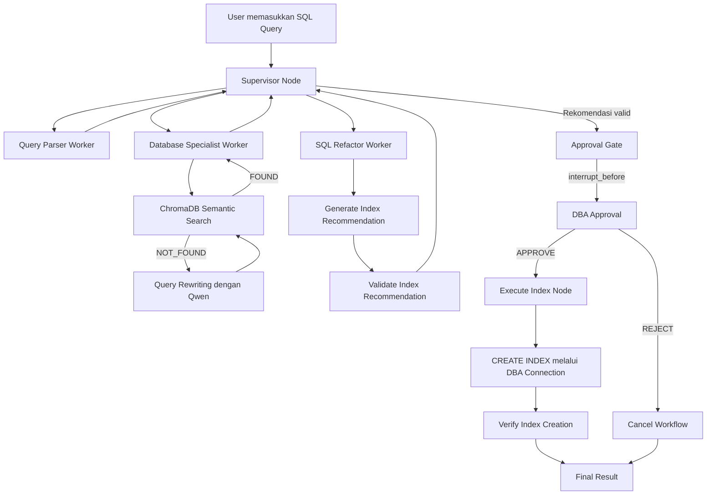

# Automated Database Query Optimizer & Indexing Advisor

Project Final IF-504 Kecerdasan Buatan — sistem Agentic AI untuk menganalisis query SQL, mengidentifikasi potensi masalah performa, dan memberikan rekomendasi indeks pada MySQL/MariaDB. Sistem menggunakan beberapa Worker Agents yang dikoordinasikan oleh LangGraph Supervisor, Knowledge Base berbasis RAG, serta Human-in-the-Loop (HITL) sebelum perubahan indeks dijalankan.

> **Catatan:** README ini ditulis untuk anggota tim yang baru melakukan `git clone` atau `git pull` pada Windows PowerShell. Perintah setup dapat disesuaikan untuk macOS/Linux.

---

## Daftar Isi

1. [Ringkasan Project](#1-ringkasan-project)
2. [Fitur Utama](#2-fitur-utama)
3. [Teknologi yang Digunakan](#3-teknologi-yang-digunakan)
4. [Arsitektur Sistem](#4-arsitektur-sistem)
5. [Struktur Folder](#5-struktur-folder)
6. [Persiapan Sebelum Menjalankan](#6-persiapan-sebelum-menjalankan)
7. [Setup Setelah Clone/Pull](#7-setup-setelah-clonepull)
8. [Konfigurasi Environment](#8-konfigurasi-environment)
9. [Setup Database MySQL/MariaDB](#9-setup-database-mysqlmariadb)
10. [Setup Ollama dan Model Lokal](#10-setup-ollama-dan-model-lokal)
11. [Membangun Knowledge Base](#11-membangun-knowledge-base)
12. [Menjalankan Project](#12-menjalankan-project)
13. [Daftar 12 Tools](#13-daftar-12-tools)
14. [Penjelasan Worker Agents dan Supervisor](#14-penjelasan-worker-agents-dan-supervisor)
15. [Alur ReAct](#15-alur-react)
16. [Agentic RAG dan Self-Correction](#16-agentic-rag-dan-self-correction)
17. [Human-in-the-Loop dan Checkpointer](#17-human-in-the-loop-dan-checkpointer)
18. [Testing](#18-testing)
19. [Reset Database untuk Demo Ulang](#19-reset-database-untuk-demo-ulang)
20. [Troubleshooting](#20-troubleshooting)
21. [Batasan Implementasi](#21-batasan-implementasi)
22. [Referensi](#22-referensi)

---

## 1. Ringkasan Project

**Automated Database Query Optimizer & Indexing Advisor** adalah aplikasi berbasis Agentic AI yang membantu developer atau Database Administrator (DBA) memahami penyebab query SQL lambat dan memperoleh rekomendasi indeks berdasarkan kondisi database.

Pengguna memasukkan query `SELECT`. Sistem kemudian:

1. Memeriksa apakah query valid dan diizinkan untuk dianalisis.
2. Mengurai struktur query, tabel, kolom, kondisi `WHERE`, `JOIN`, `ORDER BY`, `GROUP BY`, dan `LIMIT`.
3. Mengambil schema, indeks yang sudah tersedia, statistik tabel, serta execution plan melalui `EXPLAIN`.
4. Mencari dokumentasi dan best practice optimasi SQL pada Knowledge Base internal.
5. Melakukan Query Rewriting dan pencarian ulang apabila pencarian Knowledge Base menghasilkan `NOT_FOUND`.
6. Menghasilkan rekomendasi indeks dan memvalidasi perintah `CREATE INDEX`.
7. Menghentikan workflow untuk meminta persetujuan DBA.
8. Menjalankan indeks hanya setelah approval, lalu memverifikasi hasilnya.

Project ini menggunakan MySQL sebagai SQL dialect. MariaDB juga dapat digunakan melalui driver MySQL-compatible `mysql+pymysql`.

### Contoh query demo

```sql
SELECT *
FROM orders
WHERE customer_id = 105
ORDER BY created_at DESC
LIMIT 10;
```

Database demo disiapkan dengan tabel `orders` berisi sekitar 100.000 data dan tanpa secondary index pada `customer_id` maupun `created_at`. Kondisi tersebut digunakan untuk memperlihatkan perbedaan execution plan sebelum dan sesudah rekomendasi indeks diterapkan.

---

## 2. Fitur Utama

- **SQL Diagnosis:** parsing query, validasi read-only, pengambilan schema dan indeks, statistik tabel, serta analisis execution plan.
- **Agentic RAG:** mencari panduan optimasi dari dokumen Knowledge Base lokal menggunakan semantic search.
- **Self-Correction:** menulis ulang query pencarian dan mencoba kembali ketika pencarian awal menghasilkan `NOT_FOUND`.
- **Multi-Agent Workflow:** tiga Worker Agents bekerja secara berurutan dan dikoordinasikan Supervisor melalui LangGraph `StateGraph`.
- **ReAct Trace:** menampilkan ringkasan `Thought`, `Action`, `Parameters`, dan `Observation` secara langsung di terminal.
- **Index Recommendation:** menghasilkan rekomendasi indeks beserta alasan, manfaat yang diharapkan, dan risikonya.
- **Human-in-the-Loop:** workflow dihentikan sebelum eksekusi indeks sampai DBA memberikan persetujuan.
- **Checkpointing:** state workflow disimpan menggunakan `MemorySaver`/`InMemorySaver` berdasarkan `thread_id`.
- **Execution Verification:** memeriksa indeks setelah perintah `CREATE INDEX` dijalankan.

---

## 3. Teknologi yang Digunakan

| Teknologi | Kegunaan |
|---|---|
| Python | Bahasa pemrograman utama. |
| LangChain | Integrasi LLM, prompt, dan definisi tools. |
| LangGraph | Orkestrasi Worker Agents menggunakan `StateGraph`, routing, checkpoint, dan interrupt. |
| Ollama | Menjalankan model AI secara lokal. |
| Qwen 2.5 7B | Model chat untuk Query Rewriting dan pembuatan rekomendasi indeks. |
| Nomic Embed Text | Mengubah dokumen dan query menjadi embedding. |
| MySQL / MariaDB | Database yang dianalisis dan menerima indeks setelah approval. |
| SQLAlchemy | Koneksi database dari Python. |
| PyMySQL | Driver MySQL untuk SQLAlchemy. |
| SQLGlot | Parsing struktur SQL dengan dialect MySQL. |
| ChromaDB | Penyimpanan vector untuk Knowledge Base. |
| langchain-chroma | Integrasi ChromaDB dengan LangChain. |
| python-dotenv | Membaca konfigurasi dari file `.env`. |

---

## 4. Arsitektur Sistem



### Pembagian peran

- **Supervisor:** menentukan Worker berikutnya berdasarkan state dan hasil pekerjaan sebelumnya.
- **Query Parser Worker:** melakukan diagnosis SQL dan mengambil informasi database.
- **Database Specialist Worker:** mencari best practice pada Knowledge Base dan melakukan Self-Correction jika diperlukan.
- **SQL Refactor Worker:** menghasilkan dan memvalidasi rekomendasi indeks.
- **Approval Gate:** checkpoint sebelum operasi yang mengubah database.
- **Execute Index Node:** menjalankan DDL menggunakan koneksi DBA setelah approval dan memverifikasi hasilnya.

Supervisor menggunakan conditional routing berbasis state agar urutan workflow dapat diprediksi dan tidak bergantung pada keputusan routing bebas dari LLM.

---

## 5. Struktur Folder

Struktur utama project:

```text
TUBES/
│
├── agents/
│   ├── __init__.py
│   ├── state.py
│   ├── react_logger.py
│   ├── query_parser.py
│   ├── database_specialist.py
│   ├── sql_refactor.py
│   ├── execution.py
│   └── supervisor.py
│
├── config/
│   ├── __init__.py
│   ├── settings.py
│   └── llm.py
│
├── database/
│   ├── __init__.py
│   ├── connection.py
│   └── setup.sql
│
├── tools/
│   ├── __init__.py
│   ├── database_tools.py
│   ├── rag_tools.py
│   ├── optimization_tools.py
│   └── execution_tools.py
│
├── knowledge_base/
│   ├── indexing_best_practices.md
│   ├── query_optimization.md
│   ├── composite_index.md
│   └── execution_plan.md
│
├── vectorstore/                 # Dibuat saat Knowledge Base dibangun
├── logs/                        # Untuk log aplikasi (jika digunakan)
│
├── .env                         # Lokal, jangan commit
├── .env.example                 # Template konfigurasi yang di-commit
├── .gitignore
├── requirements.txt
├── build_knowledge_base.py
├── test_database_tools.py
├── test_rag_tools.py
├── test_optimization_tools.py
├── test_execution_tools.py
├── test_workers.py
├── test_supervisor.py
├── test_human_approval.py
├── main.py
└── README.md
```

Keterangan folder:

| Folder/File | Kegunaan |
|---|---|
| `agents/` | State, Worker Agents, Supervisor, node eksekusi, dan ReAct logger. |
| `config/` | Membaca `.env` dan menginisialisasi model Ollama. |
| `database/` | SQL setup dan koneksi reader/DBA ke MySQL atau MariaDB. |
| `tools/` | Implementasi 12 tools yang dipakai Worker dan execution node. |
| `knowledge_base/` | Dokumen Markdown yang menjadi sumber pengetahuan RAG. |
| `vectorstore/` | Data embedding ChromaDB yang dibangun secara lokal. |
| `main.py` | Entry point aplikasi dan live demo. |
| `build_knowledge_base.py` | Memproses dokumen Markdown dan membangun ChromaDB. |
| `test_*.py` | Script pengujian komponen dan workflow. |

> Folder `vectorstore/` umumnya tidak perlu dimasukkan ke Git. Setiap anggota tim dapat membangunnya sendiri dari dokumen dalam `knowledge_base/`.

---

## 6. Persiapan Sebelum Menjalankan

Pastikan perangkat sudah memiliki:

1. **Python 3.10 atau lebih baru** (disarankan Python 3.11).
2. **Git** untuk clone/pull repository.
3. **MySQL atau MariaDB Server** yang sedang berjalan.
4. **Ollama** yang sudah ter-install.
5. **RAM yang cukup** untuk menjalankan model lokal Qwen 2.5 7B. Penggunaan RAM bergantung pada quantization, context, dan konfigurasi Ollama.
6. Terminal PowerShell atau terminal lain yang dapat menjalankan Python.

Model Ollama diunduh terpisah dari package Python. Setiap anggota tim perlu mengunduh model yang digunakan project.

---

## 7. Setup Setelah Clone/Pull

### 7.1. Clone repository

Ganti URL repository dengan URL GitHub project tim.

```powershell
git clone <URL_REPOSITORY>
cd <NAMA_FOLDER_PROJECT>
```

Jika repository sudah ada dan ingin mengambil perubahan terbaru:

```powershell
git pull
```

Pastikan terminal berada di **root folder project**, yaitu folder yang berisi `main.py`, `requirements.txt`, dan folder `agents/`, `tools/`, `database/`, serta `config/`.

Periksa lokasi dan file:

```powershell
Get-Location
Get-ChildItem
```

Jangan menjalankan script dari parent folder repository karena import seperti `from tools.database_tools import ...` mengharapkan root project menjadi working directory.

### 7.2. Buat virtual environment

```powershell
python -m venv .venv
```

Aktifkan:

```powershell
.\.venv\Scripts\Activate.ps1
```

Jika PowerShell menolak aktivasi karena Execution Policy, jalankan pada terminal yang sama:

```powershell
Set-ExecutionPolicy -Scope Process -ExecutionPolicy Bypass
.\.venv\Scripts\Activate.ps1
```

Setelah aktif, terminal menampilkan prefix `(.venv)`.

### 7.3. Install Python dependencies

```powershell
python -m pip install --upgrade pip
pip install -r requirements.txt
```

Pastikan `requirements.txt` memuat dependency yang digunakan project, termasuk:

```text
langchain
langchain-core
langchain-ollama
langgraph
langgraph-checkpoint
sqlglot
sqlalchemy
pymysql
chromadb
langchain-chroma
langchain-text-splitters
python-dotenv
```

Jika tim menggunakan versi package yang sudah diuji bersama, simpan versi tersebut dalam `requirements.txt` agar hasil instalasi antaranggota lebih konsisten.

---

## 8. Konfigurasi Environment

Buat file `.env` pada root project. Jika repository menyediakan `.env.example`, salin template tersebut:

```powershell
Copy-Item .env.example .env
```

Jika belum ada `.env.example`, buat file `.env` secara manual dengan format berikut:

```env
# =========================================
# MYSQL / MARIADB
# =========================================
DB_HOST=127.0.0.1
DB_PORT=3306
DB_NAME=query_optimizer_db

# Account khusus analisis read-only
DB_READ_USER=optimizer_reader
DB_READ_PASSWORD=GANTI_PASSWORD_READER

# Account untuk operasi indeks setelah approval
DB_DBA_USER=optimizer_dba
DB_DBA_PASSWORD=GANTI_PASSWORD_DBA

# =========================================
# OLLAMA
# =========================================
OLLAMA_BASE_URL=http://localhost:11434
OLLAMA_MODEL=qwen2.5:7b
OLLAMA_EMBED_MODEL=nomic-embed-text
```

Sesuaikan nilai password dengan account database yang dibuat pada bagian berikutnya.

**Jangan commit atau mengunggah `.env` ke GitHub.** Pastikan `.env` tercantum di `.gitignore`. Yang boleh dimasukkan ke repository adalah `.env.example` dengan nilai password placeholder, bukan password asli.

---

## 9. Setup Database MySQL/MariaDB

### 9.1. Jalankan SQL setup

Jalankan file `database/setup.sql` menggunakan MySQL Workbench, HeidiSQL, phpMyAdmin, atau MariaDB client.

Script setup project menyiapkan:

- Database `query_optimizer_db`.
- Tabel `customers`.
- Tabel `orders`.
- Sekitar 1.000 data customer.
- Sekitar 100.000 data order.
- Primary Key pada tabel.
- Tidak membuat secondary index pada `orders.customer_id` dan `orders.created_at`, karena dua kolom ini digunakan untuk skenario optimasi.

Jika menggunakan MySQL/MariaDB CLI dari PowerShell, salah satu caranya:

```powershell
Get-Content .\database\setup.sql | mysql -u root -p
```

> Perhatikan bahwa script setup versi demo dapat melakukan `DROP TABLE IF EXISTS` sebelum membuat tabel. Jalankan hanya pada database pengujian karena menjalankannya ulang dapat menghapus dan membuat ulang tabel beserta data demo.

### 9.2. Buat database users

Jalankan SQL berikut menggunakan account administrator database. Ganti password sesuai nilai pada `.env`.

```sql
CREATE USER IF NOT EXISTS 'optimizer_reader'@'127.0.0.1'
IDENTIFIED BY 'GANTI_PASSWORD_READER';

GRANT SELECT ON query_optimizer_db.*
TO 'optimizer_reader'@'127.0.0.1';

CREATE USER IF NOT EXISTS 'optimizer_dba'@'127.0.0.1'
IDENTIFIED BY 'GANTI_PASSWORD_DBA';

GRANT SELECT, INDEX ON query_optimizer_db.*
TO 'optimizer_dba'@'127.0.0.1';

FLUSH PRIVILEGES;
```

Jika user sudah pernah dibuat dengan password berbeda, `CREATE USER IF NOT EXISTS` tidak mengganti password yang lama. Gunakan `ALTER USER` untuk memperbarui password sesuai konfigurasi `.env`.

### 9.3. Pembagian hak akses

| Account | Permission | Dipakai oleh |
|---|---|---|
| `optimizer_reader` | `SELECT` | SQL parsing support, pembacaan schema, statistik, indeks, dan `EXPLAIN`. |
| `optimizer_dba` | `SELECT`, `INDEX` | Execute Index Node untuk membuat indeks setelah approval. |

Aplikasi menggunakan dua koneksi SQLAlchemy yang berbeda:

- `read_engine`: memakai user `optimizer_reader`.
- `dba_engine`: memakai user `optimizer_dba`.

Pemisahan ini membatasi akses perubahan database hanya pada node eksekusi.

### 9.4. Verifikasi database

Jalankan:

```powershell
python -m database.connection
```

Kedua koneksi diharapkan berhasil. Pastikan database yang terdeteksi adalah `query_optimizer_db` dan user yang tampil sesuai dengan masing-masing account.

Verifikasi data melalui SQL:

```sql
USE query_optimizer_db;

SELECT COUNT(*) AS total_customers FROM customers;
SELECT COUNT(*) AS total_orders FROM orders;

SHOW INDEX FROM orders;

EXPLAIN
SELECT *
FROM orders
WHERE customer_id = 105
ORDER BY created_at DESC
LIMIT 10;
```

Baseline yang diharapkan sebelum indeks tambahan dibuat:

- `orders` berisi sekitar 100.000 baris.
- Indeks yang tersedia pada `orders` hanya `PRIMARY` untuk `id`.
- `EXPLAIN` umumnya menunjukkan access type `ALL` serta `Using where; Using filesort`.

Nilai `rows` dari `EXPLAIN` adalah estimasi optimizer, bukan jumlah baris aktual yang pasti.

---

## 10. Setup Ollama dan Model Lokal

Pastikan Ollama sudah ter-install dan server Ollama berjalan. Di Windows, Ollama biasanya aktif sebagai aplikasi background setelah dijalankan.

Periksa instalasi:

```powershell
ollama --version
ollama list
```

Unduh model chat:

```powershell
ollama pull qwen2.5:7b
```

Unduh model embedding:

```powershell
ollama pull nomic-embed-text
```

Periksa kembali:

```powershell
ollama list
```

Tes Qwen:

```powershell
ollama run qwen2.5:7b
```

Ketik pertanyaan sederhana, lalu keluar dengan `/bye`.

Project menggunakan:

- `qwen2.5:7b` melalui `ChatOllama` untuk Query Rewriting dan pembuatan rekomendasi indeks.
- `nomic-embed-text` melalui `OllamaEmbeddings` untuk embedding dokumen dan query pencarian Knowledge Base.

Jika model belum ditemukan, jalankan `ollama pull` dengan nama model yang sama seperti pada `.env`.

---

## 11. Membangun Knowledge Base

Dokumen Knowledge Base disimpan dalam folder `knowledge_base/` dalam format Markdown:

| File | Isi |
|---|---|
| `indexing_best_practices.md` | Best practice indexing, selectivity, dan biaya pemeliharaan indeks. |
| `query_optimization.md` | Optimasi `WHERE`, `JOIN`, `ORDER BY`, `LIMIT`, dan evaluasi query. |
| `composite_index.md` | Composite Index, urutan kolom, dan leftmost-prefix principle. |
| `execution_plan.md` | Penjelasan kolom dan access type pada hasil `EXPLAIN`. |

Bangun vector database:

```powershell
python build_knowledge_base.py
```

Proses ini:

1. Membaca dokumen Markdown.
2. Memberikan metadata sumber dan kategori.
3. Memecah dokumen menggunakan `RecursiveCharacterTextSplitter` dengan chunk size 900 karakter dan overlap 150 karakter.
4. Menghasilkan embedding menggunakan `nomic-embed-text`.
5. Menyimpan chunks dan embedding ke ChromaDB.

Konfigurasi collection yang digunakan:

- Collection: `sql_optimization_knowledge`.
- Penyimpanan lokal: `vectorstore/chroma_db/`.
- Similarity space: cosine.

Script build membangun ulang collection project yang sama. Jalankan kembali apabila dokumen Knowledge Base diubah. Folder vectorstore dihasilkan secara lokal dan dapat dibuat ulang dari dokumen Markdown.

---

## 12. Menjalankan Project

### 12.1. Jalankan aplikasi utama

Pastikan:

- Virtual environment aktif.
- MySQL/MariaDB berjalan.
- User database dan `.env` sudah benar.
- Ollama berjalan dan model tersedia.
- Knowledge Base sudah dibangun.

Kemudian jalankan dari root project:

```powershell
python main.py
```

Aplikasi akan meminta SQL query. Tekan Enter untuk menggunakan query demo default atau masukkan query `SELECT` sendiri.

### 12.2. Alur penggunaan

1. User memasukkan query SQL.
2. Supervisor mengarahkan workflow ke Query Parser Worker.
3. Query Parser memvalidasi dan menganalisis query serta mengambil informasi database.
4. Supervisor mengarahkan workflow ke Database Specialist Worker.
5. Database Specialist mencari Knowledge Base. Jika `NOT_FOUND`, worker meminta Qwen menulis ulang query dan melakukan satu kali pencarian ulang.
6. SQL Refactor Worker menghasilkan rekomendasi indeks menggunakan Qwen.
7. Python memvalidasi SQL rekomendasi terhadap schema dan indeks yang sudah ada.
8. LangGraph menghentikan workflow di approval checkpoint.
9. Aplikasi menampilkan rekomendasi dan meminta keputusan DBA.
10. Jika disetujui, Execute Index Node menjalankan `CREATE INDEX` menggunakan koneksi DBA, lalu memverifikasi indeks menggunakan koneksi reader.
11. Jika ditolak, eksekusi dilewati dan database tidak diubah.
12. Setelah eksekusi sukses, aplikasi menampilkan execution plan terbaru sebagai perbandingan.

### 12.3. DBA Approval

Pada prompt approval:

- Pilih `1` untuk **APPROVE**.
- Pilih `2` untuk **REJECT**.

Versi `main.py` yang telah disesuaikan juga dapat menerima teks `APPROVE` atau `REJECT` bila opsi tersebut diaktifkan pada kode input.

**Jangan menghentikan aplikasi saat workflow sedang menunggu approval**, karena checkpointer yang digunakan adalah in-memory.

---

## 13. Daftar 12 Tools

### A. Query Parser Worker — 6 tools

| No. | Tool | Fungsi | Parameter |
|---:|---|---|---|
| 1 | `parse_sql` | Mengurai tabel, kolom, `WHERE`, `JOIN`, `ORDER BY`, `GROUP BY`, dan `LIMIT`. | `sql_query` |
| 2 | `validate_sql` | Memeriksa query agar hanya satu query `SELECT` read-only yang diizinkan. | `sql_query` |
| 3 | `get_table_schema` | Mengambil kolom, tipe data, Primary Key, dan Foreign Key. | `table_name`, `schema_name` (opsional) |
| 4 | `get_existing_indexes` | Mengambil indeks yang sudah tersedia pada tabel. | `table_name`, `schema_name` (opsional) |
| 5 | `explain_query` | Menjalankan `EXPLAIN` untuk melihat execution plan. | `sql_query` |
| 6 | `get_table_statistics` | Mengambil estimasi jumlah baris, ukuran tabel, engine, dan cardinality indeks. | `table_name`, `schema_name` (opsional) |

### B. Database Specialist Worker — 2 tools

| No. | Tool | Fungsi | Parameter |
|---:|---|---|---|
| 7 | `search_knowledge_base` | Mencari dokumen relevan di ChromaDB menggunakan semantic search. | `query`, `top_k`, `category` (opsional) |
| 8 | `rewrite_search_query` | Menulis ulang query pencarian menggunakan Qwen ketika hasil awal `NOT_FOUND`. | `original_query`, `failure_reason`, `sql_context` (opsional) |

### C. SQL Refactor Worker — 2 tools

| No. | Tool | Fungsi | Parameter |
|---:|---|---|---|
| 9 | `generate_index_recommendation` | Menganalisis query dan konteks database untuk menghasilkan rekomendasi indeks. | `sql_query`, `execution_plan`, `table_schema`, `existing_indexes`, `knowledge_context` |
| 10 | `validate_index_recommendation` | Memeriksa format `CREATE INDEX`, tabel, kolom, nama indeks, dan kemungkinan redundansi. | `create_index_sql`, `table_schema`, `existing_indexes` |

### D. Execute Index Node — 2 tools

| No. | Tool | Fungsi | Parameter |
|---:|---|---|---|
| 11 | `execute_create_index` | Menjalankan perintah `CREATE INDEX` menggunakan koneksi DBA setelah approval. | `create_index_sql` |
| 12 | `verify_index_creation` | Memeriksa apakah indeks sudah terdaftar pada tabel. | `table_name`, `index_name`, `schema_name` (opsional) |

> `execute_create_index` tidak boleh diberikan kepada LLM melalui `bind_tools()`. Tool tersebut hanya dipanggil oleh `execute_index_node` setelah status approval, SQL yang disetujui, dan validasi diperiksa kembali.

---

## 14. Penjelasan Worker Agents dan Supervisor

### 14.1. Query Parser Worker

File: `agents/query_parser.py`

Tugas:

- Menjalankan validasi SQL.
- Mengurai struktur query.
- Mengidentifikasi tabel yang digunakan.
- Mengambil schema, indeks, dan statistik setiap tabel.
- Mengambil execution plan menggunakan `EXPLAIN`.
- Menyimpan hasil analisis ke shared state.

Worker ini menggunakan enam Database Analysis Tools.

### 14.2. Database Specialist Worker

File: `agents/database_specialist.py`

Tugas:

- Membentuk query pencarian dari struktur SQL.
- Mencari best practice pada ChromaDB.
- Memeriksa status hasil pencarian.
- Jika `NOT_FOUND`, memanggil `rewrite_search_query`.
- Melakukan maksimal satu kali retry pencarian.
- Menyusun `knowledge_context` untuk SQL Refactor Worker.

Status pencarian:

| Status | Makna | Perilaku |
|---|---|---|
| `FOUND` | Dokumen relevan ditemukan. | Context diteruskan ke SQL Refactor. |
| `NOT_FOUND` | Tidak ada dokumen yang melewati threshold relevansi. | Query ditulis ulang dan dicoba kembali satu kali. |
| `ERROR` | Terjadi masalah teknis pada proses retrieval. | Workflow dihentikan dan error dilaporkan. |

### 14.3. SQL Refactor Worker

File: `agents/sql_refactor.py`

Tugas:

- Mengambil SQL query, execution plan, schema, existing indexes, dan Knowledge Context.
- Meminta Qwen menghasilkan rekomendasi indeks dalam format JSON.
- Memeriksa kelengkapan hasil rekomendasi.
- Memvalidasi SQL menggunakan `validate_index_recommendation`.
- Mengirim hasil valid ke Supervisor untuk menuju approval gate.

### 14.4. Supervisor Agent

File: `agents/supervisor.py`

Supervisor menggunakan conditional routing berdasarkan shared state.

| Kondisi | Routing |
|---|---|
| Query belum dianalisis | `query_parser` |
| Knowledge Context belum tersedia | `database_specialist` |
| Rekomendasi belum tersedia | `sql_refactor` |
| Rekomendasi valid | `approval_gate` |
| Terjadi error atau rekomendasi tidak valid | `END` |
| Tidak diperlukan rekomendasi indeks | `END` |

Supervisor menggunakan routing deterministik agar alur worker terkontrol dan menghindari routing berulang tanpa tujuan.

---

## 15. Alur ReAct

Project menerapkan pola ReAct-style diagnostic loop:

- **Thought:** ringkasan alasan atau tujuan langkah berikutnya.
- **Action:** nama tool atau aksi yang dijalankan.
- **Parameters:** input yang dikirim ke tool.
- **Observation:** hasil yang dikembalikan tool.

ReAct logger berada pada `agents/react_logger.py`. Setiap worker memanggil helper `record_react()` setelah tool selesai dijalankan. Log ditampilkan secara langsung di terminal dan disimpan pada state `trace`.

Contoh alur:

```text
THOUGHT: Pastikan query valid dan read-only.
ACTION: validate_sql
PARAMETERS: {"sql_query": "SELECT ..."}
OBSERVATION: {"valid": true, "read_only": true}

THOUGHT: Periksa execution plan untuk menemukan potensi full scan.
ACTION: explain_query
PARAMETERS: {"sql_query": "SELECT ..."}
OBSERVATION: {"type": "ALL", "rows": 100010, ...}
```

**Catatan transparansi:** Thought yang ditampilkan merupakan ringkasan tujuan langkah yang ditulis pada kode Worker untuk menjelaskan tindakan sistem. Itu bukan raw internal reasoning atau hidden chain-of-thought dari model Qwen.

---

## 16. Agentic RAG dan Self-Correction

Dokumen Markdown pada `knowledge_base/` dibaca, dipecah menjadi chunks, diubah menjadi embedding oleh Nomic, dan disimpan di ChromaDB.

Ketika Database Specialist membutuhkan panduan, query pencarian juga diubah menjadi embedding. ChromaDB mengambil dokumen yang paling relevan berdasarkan semantic similarity.

Konfigurasi pencarian saat ini:

- `top_k`: default 3.
- Similarity space: cosine.
- Minimum relevance score: `0.35` pada `tools/rag_tools.py`.
- Filter kategori untuk pencarian indexing: `indexing`.
- Maksimal satu Query Rewriting dan satu retry dalam satu pemanggilan Worker.

Threshold 0.35 adalah konfigurasi awal project dan perlu dievaluasi berdasarkan hasil pencarian nyata. Jika terlalu tinggi, dokumen relevan dapat berstatus `NOT_FOUND`; jika terlalu rendah, dokumen yang kurang relevan dapat ikut diteruskan.

---

## 17. Human-in-the-Loop dan Checkpointer

### 17.1. Alur approval

1. SQL Refactor Worker membuat rekomendasi.
2. Python memvalidasi rekomendasi.
3. Supervisor mengarahkan workflow ke `approval_gate`.
4. LangGraph berhenti melalui `interrupt_before=["approval_gate"]`.
5. Aplikasi mengambil checkpoint dan menampilkan rekomendasi ke DBA.
6. DBA memilih `APPROVE` atau `REJECT`.
7. Keputusan dan SQL yang disetujui disimpan pada checkpoint menggunakan `graph.update_state()`.
8. Workflow dilanjutkan dengan `graph.invoke(None, config=...)`.
9. Execute Index Node memeriksa approval dan exact match SQL sebelum menjalankan DDL.
10. Indeks diverifikasi menggunakan `verify_index_creation`.

### 17.2. Checkpointer dan thread ID

Graph dibuat dengan checkpointer dari:

```python
from langgraph.checkpoint.memory import MemorySaver
```

Pada versi LangGraph saat ini, `MemorySaver` merupakan alias kompatibilitas untuk `InMemorySaver`.

Setiap eksekusi menggunakan `thread_id`:

```python
config = {
    "configurable": {
        "thread_id": "unique-workflow-id"
    }
}
```

`thread_id` menghubungkan state sebelum interrupt dengan proses resume setelah approval.

**Batasan:** InMemorySaver menyimpan checkpoint di RAM proses. Jangan tutup aplikasi saat menunggu approval. Jika proses Python berhenti, checkpoint in-memory hilang. Untuk persistence yang tahan restart, gunakan checkpointer database seperti PostgreSQL atau SQLite yang sesuai dengan kebutuhan dan integrasi LangGraph.

### 17.3. Proteksi operasi DDL

- Analisis dilakukan menggunakan account `optimizer_reader`.
- Eksekusi indeks memakai account `optimizer_dba`.
- Tool eksekusi tidak di-bind sebagai tool LLM.
- Execute Index Node memerlukan `approval_status == "APPROVED"`.
- SQL yang disetujui harus sama dengan SQL rekomendasi yang disimpan.
- SQL diperiksa kembali terhadap schema dan existing indexes sebelum dieksekusi.

---

## 18. Testing

Jalankan pengujian dari root folder project, dengan virtual environment aktif.

| Urutan | Perintah | Tujuan |
|---:|---|---|
| 1 | `python -m database.connection` | Menguji koneksi reader dan DBA. |
| 2 | `python test_database_tools.py` | Menguji enam tools analisis database. |
| 3 | `python build_knowledge_base.py` | Membuat atau membangun ulang ChromaDB. |
| 4 | `python test_rag_tools.py` | Menguji semantic search, NOT_FOUND, rewriting, dan retry. |
| 5 | `python test_optimization_tools.py` | Menguji pembuatan dan validasi rekomendasi indeks. |
| 6 | `python test_execution_tools.py` | Menguji verifikasi indeks dan penolakan SQL/kolom yang tidak valid. |
| 7 | `python test_workers.py` | Menguji ketiga Worker secara berurutan tanpa Supervisor. |
| 8 | `python test_supervisor.py` | Menguji routing Supervisor dan StateGraph sampai approval gate. |
| 9 | `python test_human_approval.py` | Menguji keputusan DBA, checkpoint, resume, dan eksekusi. |
| 10 | `python main.py` | Menjalankan aplikasi utama untuk live demo. |

### Urutan pengujian yang disarankan

Jalankan test dari nomor 1 sampai 8 sebelum menjalankan test yang melakukan approval `APPROVE`.

`test_human_approval.py` dan `main.py` dapat benar-benar membuat indeks jika DBA memilih approve. Setelah indeks dibuat, pengujian yang mengharapkan indeks belum ada perlu dijalankan ulang setelah database di-reset.

### Pengujian REJECT

Pilih `REJECT`. Expected result:

- Approval status tersimpan sebagai `REJECTED`.
- Execute Index Node tidak menjalankan `CREATE INDEX`.
- Workflow berakhir dengan status `REJECTED`.
- Tidak ada perubahan indeks pada database.

### Pengujian APPROVE

Pilih `APPROVE`. Expected result:

- Approval status tersimpan sebagai `APPROVED`.
- Execute Index Node menjalankan `CREATE INDEX`.
- `verify_index_creation` mengembalikan status `VERIFIED`.
- Workflow berakhir dengan status `COMPLETED`.
- Indeks baru muncul pada `SHOW INDEX FROM orders`.

---

## 19. Reset Database untuk Demo Ulang

Setelah satu kali demo `APPROVE`, indeks rekomendasi sudah ada. Untuk mendemonstrasikan proses pembuatan indeks dari kondisi awal, hapus indeks tersebut pada database demo:

```sql
USE query_optimizer_db;

DROP INDEX idx_orders_customer_created ON orders;

ANALYZE TABLE orders;
```

Pastikan nama indeks sesuai dengan hasil `SHOW INDEX FROM orders`. Jika nama indeks berbeda, gunakan nama yang sebenarnya.

Verifikasi baseline:

```sql
SHOW INDEX FROM orders;

EXPLAIN
SELECT *
FROM orders
WHERE customer_id = 105
ORDER BY created_at DESC
LIMIT 10;
```

> Jangan menjalankan perintah reset pada database produksi. Perintah ini hanya untuk database latihan project.

---

## 20. Troubleshooting

### A. `ModuleNotFoundError: No module named 'tools.database_tools'`

Penyebab umum: terminal tidak berada di root folder project atau file belum berada pada lokasi yang benar.

Solusi:

```powershell
Get-Location
Test-Path .\tools\database_tools.py
Test-Path .\tools\__init__.py
```

Jalankan Python dari folder yang berisi `main.py` dan folder `tools/`.

### B. MariaDB/MySQL syntax error dekat alias `current_user`

Hindari alias `current_user` pada query test koneksi. Gunakan alias lain, misalnya:

```sql
SELECT CURRENT_USER() AS db_user;
```

### C. `Access denied for user`

Periksa:

- Username dan password pada `.env`.
- Host account database (`127.0.0.1` berbeda dari `localhost` pada konfigurasi user MySQL).
- Privilege `SELECT` untuk reader.
- Privilege `SELECT, INDEX` untuk DBA.
- Apakah user yang sudah ada memiliki password lama yang berbeda.

### D. `Connection refused` atau MySQL tidak dapat dihubungi

Pastikan MySQL/MariaDB service aktif, host benar, dan port sesuai. Default pada konfigurasi project adalah `127.0.0.1:3306`.

### E. Ollama model tidak ditemukan

Periksa:

```powershell
ollama list
```

Unduh model yang diperlukan:

```powershell
ollama pull qwen2.5:7b
ollama pull nomic-embed-text
```

Pastikan nama model pada `.env` sama dengan nama yang tersedia di Ollama.

### F. Knowledge Base belum tersedia

Jika muncul pesan bahwa Knowledge Base belum diinisialisasi, jalankan:

```powershell
python build_knowledge_base.py
```

### G. RAG menghasilkan `NOT_FOUND`

Periksa apakah dokumen Markdown sudah ada dan collection sudah dibangun. Jika dokumen relevan tetap tidak terambil, evaluasi threshold `MIN_RELEVANCE_SCORE` di `tools/rag_tools.py` dan query pencariannya. Jangan menurunkan threshold secara sembarang tanpa memeriksa relevansi hasil.

### H. Index sudah ada

Jika `CREATE INDEX` gagal karena nama indeks sudah digunakan atau validator mendeteksi indeks redundan, periksa:

```sql
SHOW INDEX FROM orders;
```

Untuk demo ulang, ikuti [Reset Database untuk Demo Ulang](#19-reset-database-untuk-demo-ulang).

### I. Checkpoint tidak ditemukan setelah aplikasi ditutup

Project memakai InMemorySaver. Checkpoint hanya tersimpan di memori proses. Jalankan ulang workflow dari awal jika proses Python sudah dihentikan.

---

## 21. Batasan Implementasi

Project ini merupakan prototype akademik untuk demonstrasi optimasi indeks, bukan database optimizer siap produksi.

Beberapa batasan versi saat ini:

1. Skenario demo utama berfokus pada query `SELECT` dan tabel `orders`.
2. Query yang kompleks seperti subquery bertingkat, CTE, ekspresi fungsi, banyak JOIN, dan pola `OR` memerlukan pengembangan parser serta strategi rekomendasi lebih lanjut.
3. Query Parser dapat mengambil informasi beberapa tabel, tetapi SQL Refactor versi awal menggunakan tabel pertama sebagai target rekomendasi indeks. Rekomendasi JOIN multi-tabel belum ditangani secara menyeluruh.
4. Validator `CREATE INDEX` hanya menerima format sederhana yang didukung regex, bukan seluruh variasi sintaks MySQL.
5. Relevance threshold RAG sebesar 0.35 merupakan konfigurasi awal dan belum dikalibrasi terhadap dataset evaluasi yang besar.
6. `EXPLAIN` memberikan estimasi rencana eksekusi, bukan pengukuran runtime aktual. Klaim peningkatan waktu eksekusi perlu dibuktikan dengan benchmark terpisah.
7. `TABLE_ROWS` dan cardinality untuk InnoDB dapat berupa estimasi.
8. Penambahan indeks memakai storage dan dapat menambah overhead operasi `INSERT`, `UPDATE`, serta `DELETE`.
9. `MemorySaver`/`InMemorySaver` tidak menyimpan checkpoint secara permanen setelah proses Python berhenti.
10. Database yang digunakan untuk demo harus berupa database lokal atau database pengujian, bukan database produksi.

---

## 22. Referensi

- [LangGraph — MemorySaver reference](https://reference.langchain.com/python/langgraph.checkpoint.memory/MemorySaver)
- [LangGraph — InMemorySaver reference](https://reference.langchain.com/python/langgraph.checkpoint.memory/InMemorySaver)
- [LangGraph — Checkpointing](https://docs.langchain.com/oss/python/langgraph/persistence)
- [LangGraph — Interrupts](https://docs.langchain.com/oss/python/langgraph/interrupts)
- [LangChain — Ollama integration](https://reference.langchain.com/python/langchain-ollama)
- [LangChain — Chroma integration](https://docs.langchain.com/oss/python/integrations/vectorstores/chroma)
- [SQLGlot documentation](https://sqlglot.com/)
- [SQLAlchemy documentation](https://docs.sqlalchemy.org/)
- [MySQL — EXPLAIN](https://dev.mysql.com/doc/refman/8.4/en/explain.html)
- [MariaDB — CREATE INDEX](https://mariadb.com/kb/en/create-index/)

---

## Ringkasan

Automated Database Query Optimizer & Indexing Advisor menggabungkan SQL analysis tools, Agentic RAG, tiga Worker Agents, Supervisor LangGraph, ReAct-style trace, dan Human-in-the-Loop. Sistem membantu DBA memahami masalah query dan memperoleh rekomendasi indeks, sementara perubahan database tetap memerlukan persetujuan manusia sebelum dieksekusi.
